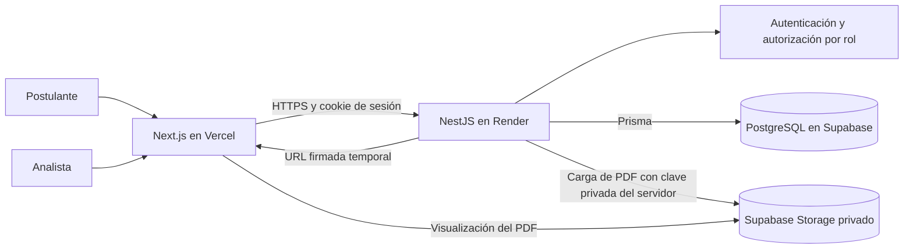

# Reto-Kata

Plataforma web para gestionar postulaciones a prácticas profesionales. Los postulantes crean una cuenta, envían sus datos y adjuntan su hoja de vida en PDF; el equipo de selección revisa cada candidatura y registra su decisión.

**Autor:** Carlos Andrés Aponte Bustos · **Repositorio:** [DarkOne10/Reto-Kata](https://github.com/DarkOne10/Reto-Kata)

**Aplicación:** [reto-kata-aval.vercel.app](https://reto-kata-aval.vercel.app) · **API:** [reto-kata.onrender.com](https://reto-kata.onrender.com) · [Swagger](https://reto-kata.onrender.com/api/docs)

## Funcionalidades

- Registro e inicio de sesión con roles de postulante, analista y administrador.
- Panel personal para consultar el estado de las postulaciones propias.
- Formulario de postulación con validación y carga de PDF de hasta 5 MB.
- Almacenamiento privado de hojas de vida en Supabase Storage.
- Dashboard de analista con postulaciones por día, resumen por estado y registros recientes.
- Revisión del detalle y visualización del CV mediante enlaces firmados de corta duración.
- Decisión de selección: viable o no viable.

## Arquitectura



El navegador nunca recibe la clave secreta de Supabase. El bucket `candidate-resumes` es privado; la API genera enlaces firmados para que analistas y administradores autorizados puedan visualizar las hojas de vida.

## Tecnologías

- **Frontend:** Next.js, React, TypeScript, Tailwind CSS y Recharts.
- **Backend:** NestJS, TypeScript, Prisma y Swagger.
- **Persistencia:** PostgreSQL administrado por Supabase.
- **Archivos:** Supabase Storage.
- **Despliegue:** Vercel para el frontend y Render para el backend.

## Estructura

```text
Reto-Kata/
├── reto-kata-backend/              API NestJS
│   ├── prisma/
│   │   ├── migrations/              Historial de migraciones de PostgreSQL
│   │   ├── schema.prisma            Modelos y enums de Prisma
│   │   └── seed-demo-users.mjs      Datos de demostración para local
│   ├── src/
│   │   ├── auth/                    Login, registro, sesión y roles
│   │   ├── candidates/              Postulaciones, estados y hojas de vida
│   │   ├── messages/                Módulo auxiliar de mensajes
│   │   ├── prisma/                  Servicio de acceso a la base de datos
│   │   ├── users/                   Administración de usuarios
│   │   ├── app.module.ts            Módulo raíz de NestJS
│   │   └── main.ts                  Arranque, CORS y Swagger
│   └── test/                        Pruebas end-to-end
├── reto-kata-frontend/              Aplicación Next.js
│   ├── app/
│   │   ├── application/             Formulario y panel del postulante
│   │   ├── dashboard/               Panel del analista
│   │   ├── login/                   Inicio de sesión
│   │   ├── register/                Registro
│   │   ├── requests/                Lista y detalle de candidatos
│   │   └── settings/                Configuración de usuarios
│   ├── components/                  Componentes y vistas reutilizables
│   │   └── ui/                      Componentes de interfaz
│   ├── hooks/                       Hooks de React
│   ├── lib/                         Cliente API y tipos compartidos
│   └── public/                      Recursos estáticos
├── LICENSE                          Licencia MIT
└── README.md                        Documentación principal
```

## Requisitos

- Node.js 22 LTS o compatible.
- npm.
- Proyecto Supabase con PostgreSQL y un bucket privado llamado `candidate-resumes`.

## Ejecución local

### Backend

Desde `reto-kata-backend`, instala dependencias y configura el archivo `.env` basándote en `.env.example`:

```bash
cd reto-kata-backend
npm ci
npx prisma generate
npx prisma migrate deploy
npm run start:dev
```

Variables principales del backend:

| Variable | Descripción |
| --- | --- |
| `DATABASE_URL` | Conexión a PostgreSQL de Supabase. |
| `PORT` | Puerto HTTP local; por ejemplo, `8080`. |
| `CORS_ORIGIN` | Origen autorizado del frontend; localmente, `http://localhost:3000`. |
| `JWT_SECRET` | Secreto aleatorio para firmar las sesiones. |
| `SUPABASE_URL` | URL del proyecto Supabase. |
| `SUPABASE_SECRET_KEY` | Clave secreta usada solo por el backend. |
| `SUPABASE_BUCKET` | Nombre del bucket privado; `candidate-resumes`. |

No subas `.env` a Git. No uses una clave `SUPABASE_SECRET_KEY` en el frontend ni en variables `NEXT_PUBLIC_*`.

### Frontend

En `reto-kata-frontend/.env.local`, configura la URL de la API local:

```env
NEXT_PUBLIC_API_URL=http://localhost:8080/api
```

Después inicia Next.js:

```bash
cd reto-kata-frontend
npm ci
npm run dev
```

Abre [http://localhost:3000](http://localhost:3000). Para probar cuentas de demostración en local, configura las variables `DEMO_*` del backend y ejecuta `npm run seed:demo-users`. No uses esas credenciales de demostración en producción.

## API principal

Todas las rutas usan el prefijo `/api`.

| Método | Ruta | Acceso | Uso |
| --- | --- | --- | --- |
| `POST` | `/auth/register` | Público | Registrar una cuenta de postulante. |
| `POST` | `/auth/login` | Público | Iniciar sesión. |
| `POST` | `/auth/logout` | Sesión | Cerrar sesión. |
| `POST` | `/candidates` | Postulante | Crear postulación y subir el PDF (`multipart/form-data`). |
| `GET` | `/candidates/mine` | Postulante | Consultar las postulaciones propias. |
| `GET` | `/candidates` | Analista/administrador | Listar postulaciones. |
| `GET` | `/candidates/:id` | Analista/administrador | Consultar el detalle. |
| `GET` | `/candidates/:id/resume` | Analista/administrador | Obtener una URL firmada temporal para el CV. |
| `PATCH` | `/candidates/:id/status` | Analista/administrador | Registrar la decisión de selección. |

La documentación interactiva está disponible en `/api/docs`.

## Pruebas y validación

Desde `reto-kata-backend`:

```bash
npm test
npm run lint
npm run build
```

Desde `reto-kata-frontend`:

```bash
npm run lint
npm run build
```

## Despliegue

### Backend en Render

- Conecta el repositorio de GitHub y configura `reto-kata-backend` como **Root Directory**.
- **Build Command:** `npm ci --include=dev && npx prisma generate && npm run build`
- **Start Command:** `npx prisma migrate deploy && npm run start:prod`
- Configura en Render las variables del backend descritas arriba. Render proporciona `PORT` automáticamente.
- Define `CORS_ORIGIN` con el dominio de producción de Vercel, sin ruta ni barra final.

### Frontend en Vercel

- Conecta el mismo repositorio y configura `reto-kata-frontend` como **Root Directory**.
- Define `NEXT_PUBLIC_API_URL` con la URL de Render seguida de `/api`.
- No configures secretos de Supabase en Vercel.

La base de datos continúa siendo la misma instancia de Supabase. `prisma migrate deploy` aplica únicamente las migraciones pendientes; no uses `prisma migrate reset` en producción.

## Seguridad y privacidad

- El bucket de CV debe permanecer privado y limitarse a PDF de hasta 5 MB.
- Las claves privadas y contraseñas se guardan en variables de entorno del backend o del proveedor; nunca en el repositorio.
- Los CV se entregan a personal autorizado mediante enlaces temporales.
- Antes de abrir el servicio a más usuarios, añade el aviso y consentimiento de privacidad correspondiente al tratamiento de datos personales y hojas de vida.

## Licencia

Este proyecto se distribuye bajo la licencia MIT. Consulta el archivo [LICENSE](LICENSE) para ver sus términos.